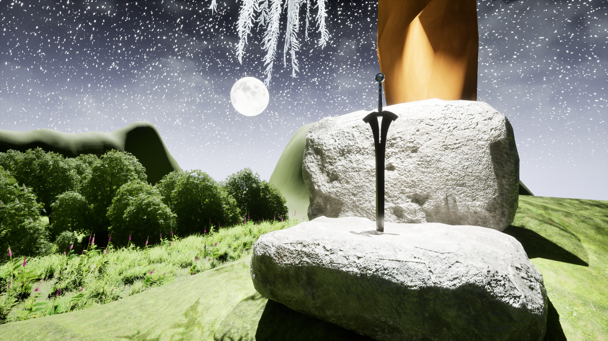
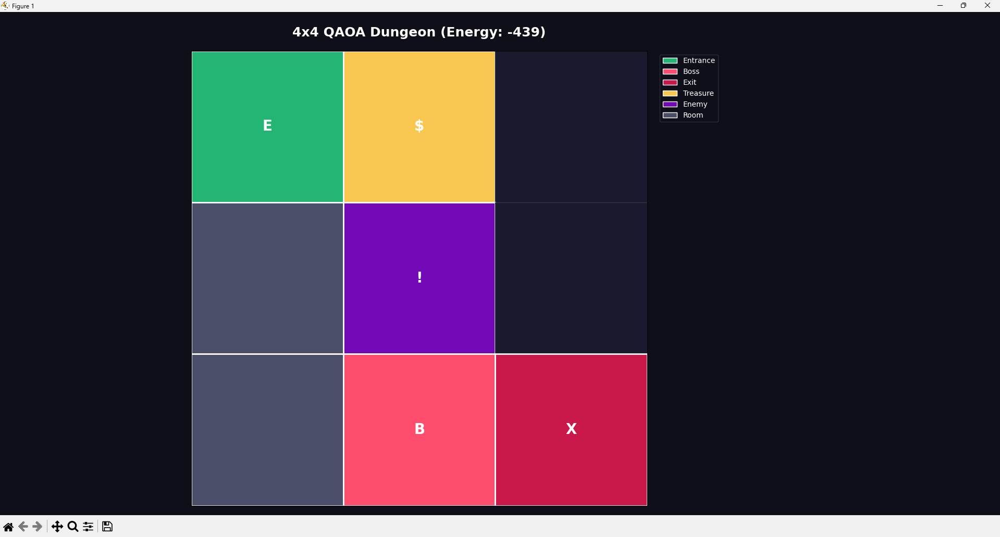
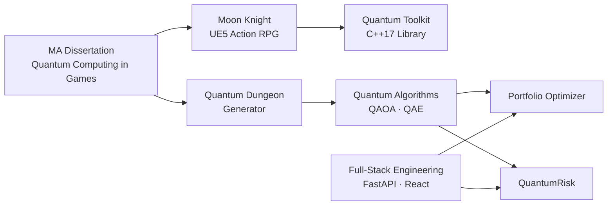

---

## About Me

Game developer and engineer with an **MA in Game Development (Distinction)** from Kingston University, where my dissertation explored how quantum computing could reshape RPG mechanics. I work across three tracks:

- 🎮 **Game development** - Unreal Engine 5 systems in C++ and Blueprints: combat, enemy AI, data-driven equipment, diegetic UI
- 💻 **Software engineering** - full-stack web apps with FastAPI, React and Next.js, including authentication, databases and deployment
- ⚛️ **Quantum computing** - QAOA optimisation, QUBO encoding and amplitude estimation with IBM Qiskit, plus a C++17 quantum mechanics library

---

## Tech Stack

**Languages** 

**Game Development** 

**Web & Backend** 

**Tools & Deployment** 

**Quantum Computing** 

---

## Featured Projects

<table>
<tr>
<td width="50%" valign="top">

<h3>Moon Knight</h3>
Solo dark fantasy action RPG and MA dissertation project. 4-hit combo system, Behaviour Tree AI, boss encounters and five quantum-inspired abilities. Shown at Develop:Brighton 2025.
  

</td>
<td width="50%" valign="top">

<h3>Quantum Dungeon Generator</h3>
Procedural dungeons generated with QAOA. Game design constraints are encoded as a QUBO problem and solved on a quantum circuit via IBM Qiskit.
  

</td>
</tr>
<tr>
<td width="50%" valign="top">

<h3>Quantum Portfolio Optimizer</h3>
Hybrid quantum-classical stock allocation: QAOA selects the assets, scipy optimises the weights. Real-time market data via yfinance.
  

</td>
<td width="50%" valign="top">

<h3>QuantumRisk <i>(In Development)</i></h3>
Quantum Amplitude Estimation compared against classical Monte Carlo for options pricing and Value at Risk.
  

</td>
</tr>
</table>

---

## Game Development

| Project | Description | Tech |
|---|---|---|
| [Quantum Toolkit](https://www.alvarogomezgames.com/) *(Private · In Development)* | C++17 library of quantum game mechanics wrapping Quantum++ and Eigen. Density-matrix registers, gates, measurement and per-qubit noise, with mechanics statistically verified over 1,000-trial tests | C++17, Quantum++, Eigen |
| [Medieval Jousting](https://github.com/alvarogope/Medieval-Jousting) *(In Development)* | Side-on jousting game built in C++ with Enhanced Input | UE5, C++ |

---

## Software Engineering

| Project | Description | Tech |
|---|---|---|
| [Game Dev Portfolio](https://github.com/alvarogope/portfolio) | Interactive portfolio site with an RPG-style About screen, Moon Knight bestiary and project system diagrams. [**Live**](https://www.alvarogomezgames.com/) | Next.js, React, TypeScript |
| [SecureAI Coding Challenge Platform](https://github.com/alvarogope/SecureAI-Coding-Challenge-Platform) | AI-generated coding challenges with Clerk authentication, per-user history and daily quotas | FastAPI, React, OpenAI, SQLite |
| [Finance Tracker](https://github.com/alvarogope/Finance-Tracker) | CLI tool for logging, filtering and visualising personal finances | Python, pandas, Matplotlib |

---

## How My Work Connects

---

## Certifications

---

*Open to game development, software engineering and quantum computing roles.*

